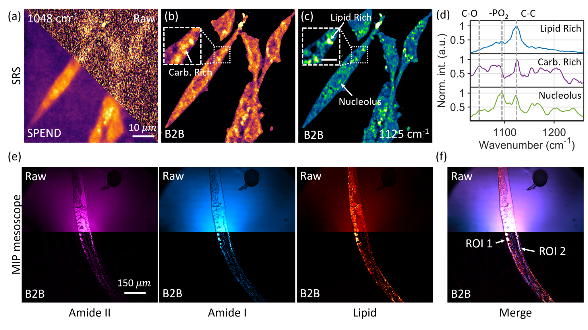
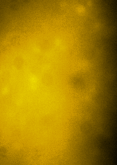

# Background2Background (B2B)

This repository contains an implementation of Background2Background (B2B), a self-supervised workflow for estimating and removing correlated backgrounds in high-dimensional microscopy. B2B uses local randomization to disrupt short-range image structure while retaining broader background variation. A 3D CARE model learns from paired original and randomized volumes; its prediction is used as the background estimate and subtracted from the input.

## Overview

Microscopy backgrounds can obscure weak biological signals, especially when they vary across space or wavelength. B2B uses the difference in correlation scales between the signal and background to learn a background estimate without a clean background reference.


### Key Features

* Local randomization creates paired input and target volumes for self-supervised training.
* A 3D CARE model based on a depth-4 U-Net estimates the background.
* The prediction script saves the estimated background, background-subtracted image, and input-to-background ratio.
* The supplied figure deck shows examples in fluorescence, stimulated Raman scattering (SRS), and mid-infrared photothermal (MIP) imaging.

## Prerequisites

The included Conda environment is a Linux-based snapshot with Python 3.9.16, TensorFlow 2.12.0, and CSBDeep 0.7.3. It includes CUDA 11.8 packages; GPU use requires a compatible NVIDIA driver and TensorFlow/CUDA setup. The environment file can be used as a starting point on another Linux system.

## Framework Details

The B2B workflow consists of four steps:

1. **Prepare paired data:** `0_datasplit_bkg_extract_B2B.py` saves the original TIFF volumes as inputs and creates locally randomized targets.
2. **Create training patches:** `1_datapre_B2B.py` reads the `Input` and `Target` folders and writes `data/my_training_data.npz`. The current patch size is `(16, 64, 64)` voxels, with 512 patches per image.
3. **Train the model:** `2_training_B2B.py` trains a 3D CARE model. The supplied defaults are 200 epochs, 20 steps per epoch, and a learning rate of `4e-5`.
4. **Predict and remove background:** `3_prediction_B2B_folder.py` predicts the background for each stack. The background-subtracted result is calculated as `input - predicted_background`.

## Installation

After cloning the B2B repository, create and activate the Conda environment from its root directory:

```bash
conda env create -f B2B_environment.yml
conda activate b2b-csbdeep
```

## Usage

Run the scripts from the repository root, in order:

```bash
python 0_datasplit_bkg_extract_B2B.py
python 1_datapre_B2B.py
python 2_training_B2B.py
python 3_prediction_B2B_folder.py
```

Before running, update the example data paths and model name in the scripts. In `0_datasplit_bkg_extract_B2B.py`, set `folder_path` to your raw 3D TIFF directory and adjust the randomization offsets to suit your data. The current defaults use offsets of 0–20 pixels in each in-plane direction and 0–1 slices along Z. **This script deletes and recreates `data/Input` and `data/Target` each time it runs.**

The training and prediction scripts must use the same model name. Prediction expects TIFF volumes with axes ordered as `ZYX`. For each input volume, the current prediction script writes:

* `bkg_...`: estimated background.
* `sub_...`: input minus estimated background.
* `devide_...`: input divided by estimated background.

## Examples

The figures below are representative examples exported from the supplied B2B figure deck. The microscopy datasets themselves are not included in this repository.

### Example applications

#### SRS and MIP imaging



#### Calcium imaging

The raw wide-field fluorescence data are from the [DeepWonder repository](https://github.com/yuanlong-o/Deep_widefield_cal_inferece).

| Raw wide-field fluorescence | B2B background-removal result |
|---|---|
|  |  |

## Citation

If you use B2B in your research, please cite:

Ding, G. et al. **Background2Background: a self-supervised background removal framework for high dimensional microscopy.** arXiv:2610.17615 (2026).

[Read the preprint](https://arxiv.org/abs/2610.17615)

## Contact

For questions about B2B, please contact Guangrui Ding at [grding@bu.edu](mailto:grding@bu.edu).


